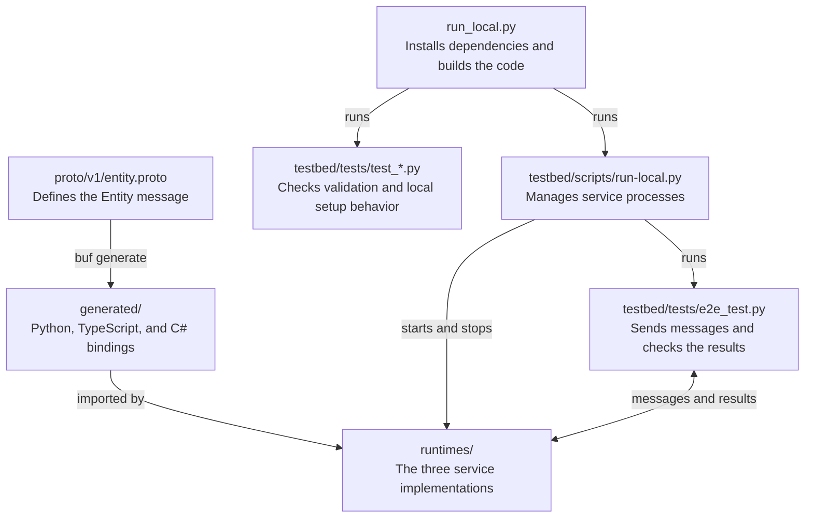
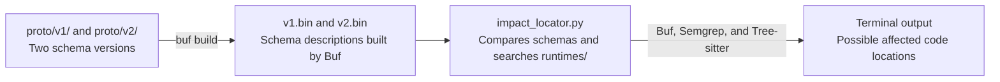

# Schema Sentinel

UCF Senior Design project for testing schema changes across Python, TypeScript,
and C#. The testbed sends one Protobuf `Entity` through all three services and
checks that each service reads the same `entity_id` and `name`.

## Run locally

Install these tools, then reopen your terminal:

| Tool | Version |
| --- | --- |
| [Python](https://www.python.org/downloads/) | 3.10 or newer |
| [Node.js and npm](https://nodejs.org/en/download) | Node.js 22 or newer |
| [.NET SDK](https://dotnet.microsoft.com/en-us/download/dotnet/8.0) | 8.0 SDK |

Open the project folder in your editor, then run the command below in its terminal.

### Windows (PowerShell or Command Prompt)

```powershell
py run_local.py
```

If `py` is unavailable, use `python run_local.py`.

### macOS and Linux

```sh
python3 run_local.py
```

The script installs the project dependencies, builds the runtimes, runs the unit
tests, and sends four test messages through Python -> TypeScript -> C#. It stops
the services when finished. Docker, Make, and Buf are not needed for this run.
The first run needs an internet connection to download dependencies.

Each case shows its input fields and a PASS result for each runtime, the returned
message, and the service order. For example:

```text
[PASS] 1/4 - Standard text
  entity_id: "roundtrip-001"
  name: "Sensor A"
  Python: PASS | TypeScript: PASS | C#: PASS
  Returned message: PASS | Service order: PASS
```

The final line should read `PASS: 4/4 round-trip cases passed.`

To repeat the checks without reinstalling dependencies, add `test` to the command.
To keep the services running for development, add `start`. Press Ctrl+C to stop them.

## Common setup problems

- **Missing `node`, `npm`, or `dotnet`:** install the tools above and reopen the
  terminal. For .NET, choose the **8.0 SDK**, not just the runtime.
- **Python is missing:** install Python. On Windows, enable its command-line
  shortcuts; on Linux, your distribution may also require `python3-venv`.
- **`run_local.py` is missing:** run from the project folder containing this README
  and `run_local.py`.
- **A port is unavailable:** stop the program using ports 8000, 8001, or 8002.
- **A service fails:** check its log in `testbed/artifacts/`.

## Project files

The schema defines the message. Generated code lets each language read and write
it. The launcher builds the project, then runs the tests and services.



The message route is `e2e_test.py -> Python :8000 -> TypeScript :8001 -> C# :8002`.
The response returns along the same path. Each service records the fields it
decoded, and the test checks those values, the returned message, and service order.
Generated bindings are already committed; the normal local run does not need Buf.

The impact locator is a separate prototype, run with its own setup and command:



`run_local.py` does not run the impact locator. See the
[impact locator guide](docs/impact-locator.md) for its setup and current limits.

- `proto/`: v1 has `entity_id` and `name`; v2 removes `name`.
- `generated/`: Protobuf bindings used by the runtimes.
- `runtimes/`: Python, TypeScript, and C# service code.
- `testbed/`: tests, logs, and the local service runner.

See [testbed development](testbed/README.md) for individual service commands and
optional Docker commands. The [impact locator guide](docs/impact-locator.md)
covers the separate Buf, Semgrep, and Tree-sitter prototype.
